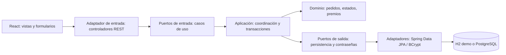
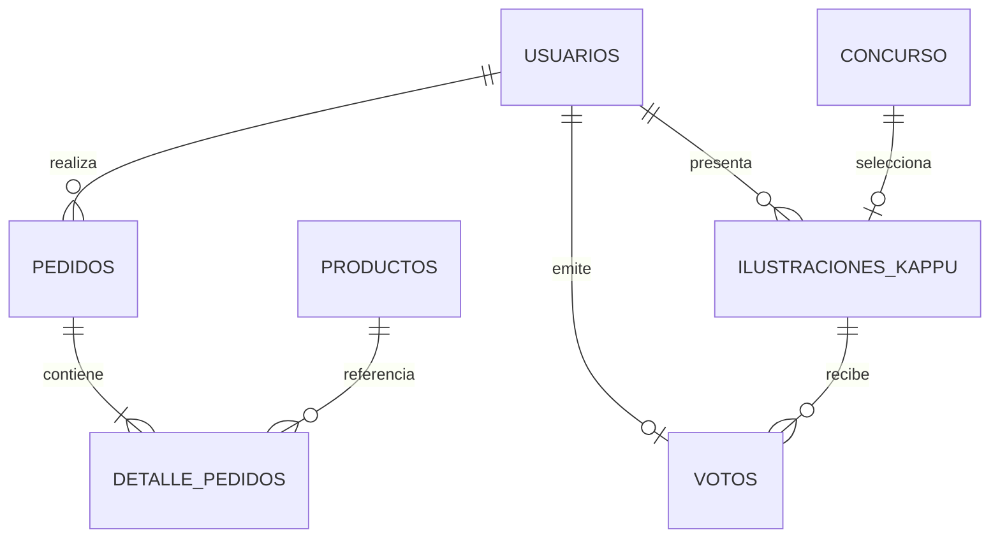

# Arquitectura y rúbrica

## Idea y problema

RadioCafé centraliza pedidos de una cafetería y vincula su comunidad a un concurso de arte. Reemplaza listas locales sin persistencia por información compartida entre clientes, administración, cocina y reparto. Kappu añade una regla diferenciadora: participación, voto único, ganador y retiro de premio con QR.

## Arquitectura elegida: hexagonal

El backend es un **monolito con puertos y adaptadores**. React es un cliente independiente; separar frontend y backend no convierte el sistema en microservicios.

| Área | Ubicación | Responsabilidad |
| --- | --- | --- |
| Dominio | `domain/model` | Estados, cálculo de envío, transición de pedidos y canje |
| Entrada al núcleo | `domain/ports/in` | Contratos de registro, catálogo, pedidos y concurso |
| Salida del núcleo | `domain/ports/out` | Contratos de repositorios y codificación de contraseñas |
| Aplicación | `application/usecases` | Coordina reglas, consultas y operaciones transaccionales |
| Entrada HTTP | `infrastructure/adapters/in/web` | DTO, validación, autenticación del actor, autorización y respuestas |
| Persistencia | `infrastructure/adapters/out/persistence` | Entidades, mapeo y repositorios JPA |
| Configuración | `infrastructure/config` | Seguridad, CORS, perfiles e inicialización |
| Vista | `radiocafe-frontend/src` | Formularios, catálogo, carrito y paneles por rol |

El dominio no importa Spring ni JPA. Los casos de uso dependen de interfaces de salida y se inyectan por constructor. La aplicación usa anotaciones Spring para servicios y transacciones; esta es una decisión pragmática y no una afirmación de independencia absoluta del framework. Las entidades JPA no se entregan directamente como respuesta de la API.

## Evidencias de Spring Boot

| Concepto | Ejemplo para explicar |
| --- | --- |
| Arranque y autoconfiguración | `RadiocafeBackendApplication` y configuración por perfiles |
| MVC y API REST | `OrderController`, métodos HTTP y códigos 201/400/401/403/404/409 |
| IoC e inyección | `CreateOrderUseCaseImpl` recibe puertos por constructor |
| JPA y relaciones | `PedidoEntity`, `DetallePedidoEntity`, cascada y repositorios |
| Consultas Spring Data | Búsqueda de pedidos por usuario y de premio por código |
| Transacciones | Creación/cambio de pedido, voto, ganador y canje |
| Concurrencia | `@Version` para pedidos y `PESSIMISTIC_WRITE` para concurso |
| Bean Validation | DTO con `@Valid`, límites, correo, precios y cantidades |
| Seguridad | BCrypt, sesión HttpOnly, CSRF, `@PreAuthorize`, propiedad de pedidos |
| Manejo de errores | `ApiExceptionHandler`, mensajes controlados y estados HTTP |
| Pruebas | Reglas de dominio, MockMvc integrado y concurrencia en H2 |

## MVC, capas y las otras opciones

- **MVC:** Spring MVC recibe las solicitudes y usa controladores REST; React presenta las vistas. No se utiliza Thymeleaf ni un `ModelAndView` del MVC tradicional.
- **N-Capas:** existen presentación, aplicación, dominio y persistencia con responsabilidades separadas.
- **Hexagonal:** es la arquitectura principal elegida y la que debe sustentarse con el flujo de puertos/adaptadores.
- **Microservicios:** no implementados; no necesarios si la lista representa alternativas. Requerirían servicios desplegables independientemente, contratos, comunicación y manejo de fallos entre procesos.
- **Agentes:** no implementados; los roles humano/cliente/barista no son agentes de software autónomos.

## Modelo de datos

Las conexiones por ID de usuario/producto/ilustración son referencias lógicas; la relación pedido-detalles sí está mapeada como asociación JPA. El nombre y precio de cada detalle son una instantánea histórica, por lo que editar o retirar un producto no altera pedidos previos. Hay un concurso global, no un calendario de múltiples ediciones.

## Extensión de operaciones

Inventario y usuarios mantienen la misma dirección de dependencias: controladores → puertos de entrada → casos de uso → puertos de salida → adaptadores JPA.

- `CreateOrderUseCaseImpl` bloquea productos por ID ordenado, verifica las cantidades agregadas y guarda stock, pedido y movimientos en una transacción.
- `ManageOrderStateUseCaseImpl` bloquea el pedido y devuelve existencias solo si ese pedido las había descontado.
- `InventoryUseCaseImpl` valida ajustes y guarda un movimiento con saldo y responsable.
- `ManageUsersUseCaseImpl` serializa las operaciones administrativas y preserva al administrador activo.
- `SessionAccountFilter` pertenece a infraestructura: compara la versión de seguridad de la sesión con la cuenta para revocar accesos antiguos.
- OpenAPI se genera sobre los adaptadores HTTP; sus anotaciones no se introducen en los modelos del dominio.

El inventario es de **unidades por producto terminado**; no modela recetas, insumos, lotes ni vencimientos. Las variantes consumen la misma existencia del producto base.
