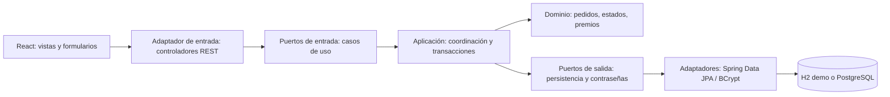
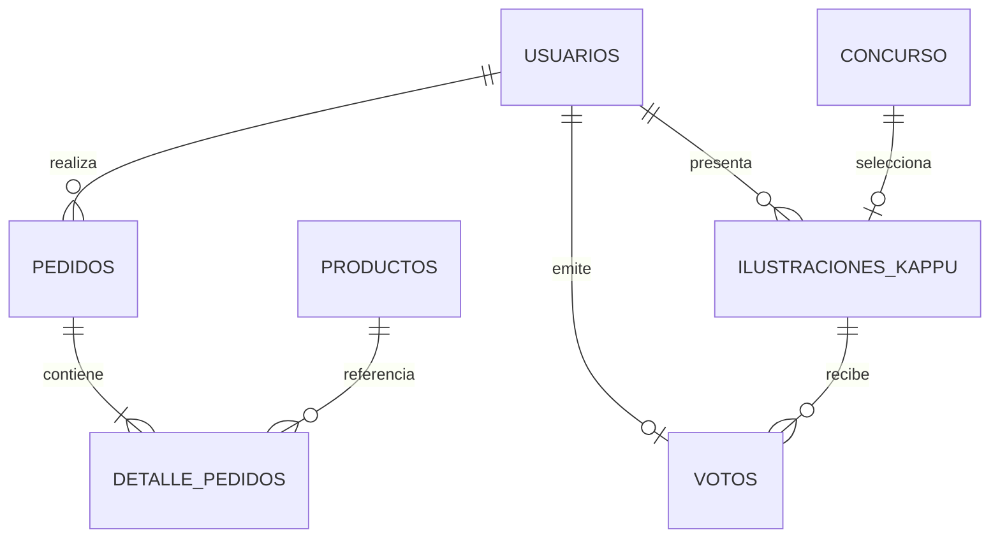

# Arquitectura y rúbrica

## Idea y problema

RadioCafé centraliza pedidos de una cafetería y vincula su comunidad a un concurso de arte. Reemplaza listas locales sin persistencia por información compartida entre clientes, administración, cocina y reparto. Kappu añade una regla diferenciadora: participación, voto único, ganador y retiro de premio con QR.

## Arquitectura elegida: hexagonal

El backend es un **monolito con puertos y adaptadores**. React es un cliente independiente; separar frontend y backend no convierte el sistema en microservicios.

| Área | Ubicación | Responsabilidad |
| --- | --- | --- |
| Dominio | `domain/model` | Estados, cálculo de envío, transición de pedidos y canje |
| Entrada al núcleo | `domain/ports/in` | Contratos de registro, catálogo, pedidos y concurso |
| Salida del núcleo | `domain/ports/out` | Contratos de repositorios y codificación de contraseñas |
| Aplicación | `application/usecases` | Coordina reglas, consultas y operaciones transaccionales |
| Entrada HTTP | `infrastructure/adapters/in/web` | DTO, validación, autenticación del actor, autorización y respuestas |
| Persistencia | `infrastructure/adapters/out/persistence` | Entidades, mapeo y repositorios JPA |
| Configuración | `infrastructure/config` | Seguridad, CORS, perfiles e inicialización |
| Vista | `radiocafe-frontend/src` | Formularios, catálogo, carrito y paneles por rol |

El dominio no importa Spring ni JPA. Los casos de uso dependen de interfaces de salida y se inyectan por constructor. La aplicación usa anotaciones Spring para servicios y transacciones; esta es una decisión pragmática y no una afirmación de independencia absoluta del framework. Las entidades JPA no se entregan directamente como respuesta de la API.

## Evidencias de Spring Boot

| Concepto | Ejemplo para explicar |
| --- | --- |
| Arranque y autoconfiguración | `RadiocafeBackendApplication` y configuración por perfiles |
| MVC y API REST | `OrderController`, métodos HTTP y códigos 201/400/401/403/404/409 |
| IoC e inyección | `CreateOrderUseCaseImpl` recibe puertos por constructor |
| JPA y relaciones | `PedidoEntity`, `DetallePedidoEntity`, cascada y repositorios |
| Consultas Spring Data | Búsqueda de pedidos por usuario y de premio por código |
| Transacciones | Creación/cambio de pedido, voto, ganador y canje |
| Concurrencia | `@Version` para pedidos y `PESSIMISTIC_WRITE` para concurso |
| Bean Validation | DTO con `@Valid`, límites, correo, precios y cantidades |
| Seguridad | BCrypt, sesión HttpOnly, CSRF, `@PreAuthorize`, propiedad de pedidos |
| Manejo de errores | `ApiExceptionHandler`, mensajes controlados y estados HTTP |
| Pruebas | Reglas de dominio, MockMvc integrado y concurrencia en H2 |

## MVC, capas y las otras opciones

- **MVC:** Spring MVC recibe las solicitudes y usa controladores REST; React presenta las vistas. No se utiliza Thymeleaf ni un `ModelAndView` del MVC tradicional.
- **N-Capas:** existen presentación, aplicación, dominio y persistencia con responsabilidades separadas.
- **Hexagonal:** es la arquitectura principal elegida y la que debe sustentarse con el flujo de puertos/adaptadores.
- **Microservicios:** no implementados; no necesarios si la lista representa alternativas. Requerirían servicios desplegables independientemente, contratos, comunicación y manejo de fallos entre procesos.
- **Agentes:** no implementados; los roles humano/cliente/barista no son agentes de software autónomos.

## Modelo de datos

Las conexiones por ID de usuario/producto/ilustración son referencias lógicas; la relación pedido-detalles sí está mapeada como asociación JPA. El nombre y precio de cada detalle son una instantánea histórica, por lo que editar o retirar un producto no altera pedidos previos. Hay un concurso global, no un calendario de múltiples ediciones.

## Extensión de operaciones

Inventario y usuarios mantienen la misma dirección de dependencias: controladores → puertos de entrada → casos de uso → puertos de salida → adaptadores JPA.

- `CreateOrderUseCaseImpl` bloquea productos por ID ordenado, verifica las cantidades agregadas y guarda stock, pedido y movimientos en una transacción.
- `ManageOrderStateUseCaseImpl` bloquea el pedido y devuelve existencias solo si ese pedido las había descontado.
- `InventoryUseCaseImpl` valida ajustes y guarda un movimiento con saldo y responsable.
- `ManageUsersUseCaseImpl` serializa las operaciones administrativas y preserva al administrador activo.
- `SessionAccountFilter` pertenece a infraestructura: compara la versión de seguridad de la sesión con la cuenta para revocar accesos antiguos.
- OpenAPI se genera sobre los adaptadores HTTP; sus anotaciones no se introducen en los modelos del dominio.

El inventario es de **unidades por producto terminado**; no modela recetas, insumos, lotes ni vencimientos. Las variantes consumen la misma existencia del producto base.

## Imágenes de productos

`ProductImagesController` recibe multipart y usa el puerto de entrada `ProductImagesUseCase`. El caso de uso comprueba formato real, tamaño y dimensiones, y recodifica JPG/PNG para quitar metadatos. El puerto de salida `ImageStoragePort` se implementa con `LocalImageStorageAdapter`, que guarda archivos con nombres UUID en una carpeta persistente. No se usan nombres ni rutas proporcionados por el navegador. El dominio conserva la URL en `Producto.imagenUrl`; no depende de HTTP ni del sistema de archivos. Solo el administrador sube o lista fotos; el contenido publicado es de lectura pública y mantiene protección CSRF en las escrituras.

## Comercio y descuentos

`CommerceController` valida DTOs y roles; `CommerceUseCase` expone campañas, descuentos, opiniones, atención, configuración y recomendaciones. `CommerceUseCaseImpl` contiene las reglas y usa `CommerceRepositoryPort`; `CommerceRepositoryAdapter` implementa la persistencia mediante repositorios JPA. Las tablas nuevas son `campanas`, `opiniones`, `consultas_atencion` y `configuracion_comercio`. No se reemplazan las tablas previas.

`CreateOrderUseCaseImpl` calcula el descuento tras obtener precios reales y dentro de la transacción que reserva existencias. El pedido conserva una instantánea del descuento. `PedidoEntity` añade columnas con descuento predeterminado cero para compatibilidad con pedidos históricos. El adaptador rehidrata esa instantánea y no vuelve a consultar campañas al leer pedidos.

`CatalogUseCaseImpl.guardarConStock` bloquea el producto, verifica el saldo anterior cuando se cambian existencias y guarda metadatos, saldo y movimiento en una transacción. La edición de metadatos que mantiene el stock del formulario no revierte ventas concurrentes. Los endpoints existentes de inventario siguen disponibles.

Las recomendaciones se ordenan por afinidad de categoría del historial propio y cantidades vendidas de pedidos no cancelados, excluyendo productos retirados o sin stock. La búsqueda y los filtros operan sobre el catálogo recibido por React. No se incorpora otro servicio ni se cambia la arquitectura del proyecto.

## Aislamiento de sesiones por ventana

`TabSecurityContextRepository` implementa `SecurityContextRepository` y delega a `HttpSessionSecurityContextRepository` con una clave distinta por UUID de ventana. No comparte instancias mutables de repositorio entre solicitudes. `TabSessionHeaderFilter` valida el selector antes de cargar el contexto. Cada identidad se autentica normalmente con Spring Security; el cliente no puede asignarse un rol indicando un encabezado.

`SessionAccountFilter` elimina el contexto de la cuenta revocada sin invalidar los de otras cuentas. Logout limpia el contexto de esa ventana y mantiene la cookie mientras existan otras identidades. La estrategia de login sigue renovando el ID de HttpSession contra fijación de sesión. React conserva solo el selector de ventana en sessionStorage, exige cookie HttpOnly y consulta la cuenta real al recargar. El UUID se renueva al iniciar sesión para evitar que una pestaña duplicada cambie la identidad de su origen.

## Disponibilidad, estimaciones, avisos y concurso

`BaristaUseCase` coordina presencia y estimaciones; `NotificationUseCase` genera avisos privados y operaciones de lectura. Ambos usan `OperationsRepositoryPort`, con adaptador JPA para `barista_disponibilidad` y `notificaciones`. Un `Clock` de infraestructura con zona America/Lima permite validar horarios y fijar el tiempo en pruebas. Los pedidos añaden campos opcionales de minutos, hora estimada y nombre del barista, sin modificar los registros previos.

Los avisos se guardan en la misma transacción de la operación que los origina. Cambios de estado y estimaciones notifican al propietario; las alertas de insumos y las inscripciones se distribuyen a administradores activos. React consulta cada 8 segundos la bandeja de su propia sesión y actualiza pedidos al detectar avisos nuevos. No se añade un servicio externo ni se cambia el aislamiento por ventana.

El concurso añade fechas y cierre al registro global y datos de participante/descripción a las ilustraciones. Cierre, participación, likes y elección usan el mismo bloqueo para congelar un ranking estable de tres finalistas. La galería pública usa DTOs sin códigos de premio. La subida de arte reutiliza la validación y recodificación JPG/PNG con un espacio de almacenamiento y URL separados. Se mantienen ganador único, canje atómico y QR autorizado.

## Perfil de cuenta y barra compartida

`AccountUseCase` añade actualización de perfil, contraseña, foto y consulta de actividad mediante los puertos existentes de usuarios, contraseñas y pedidos. Los cambios de cuenta bloquean la fila del usuario; la gestión administrativa también conserva foto/dirección y utiliza ese bloqueo para no sobrescribir datos concurrentes. `PasswordPort` expone comparación BCrypt además de codificación; `AccountController` valida la entrada y refresca solo el contexto de la ventana que cambió su contraseña.

`Usuario` y su entidad añaden foto y dirección, con constructores de dominio compatibles para los usos anteriores. `ImageStoragePort` separa avatares privados de productos y arte público. La autorización del controlador de avatar requiere propiedad, incluso para administradores.

React reutiliza `SiteHeader` en el layout y dentro del diálogo del checkout, montando una sola cabecera visible. `ProfileMenu` concentra navegación y cierre de sesión; `Profile` ofrece datos, seguridad y actividad. `FullCatalog` es independiente del buscador existente. El carrito se conserva en sessionStorage por ID de cuenta y ventana; los precios siguen recalculándose exclusivamente en el backend al confirmar.
